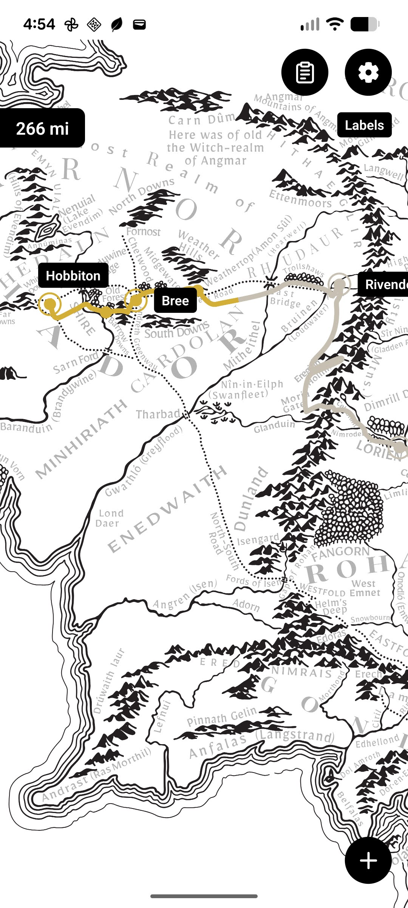
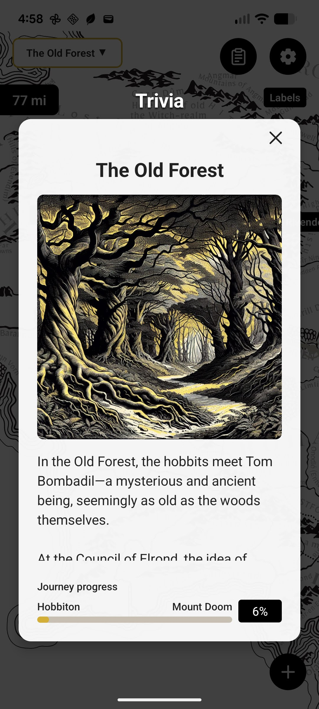
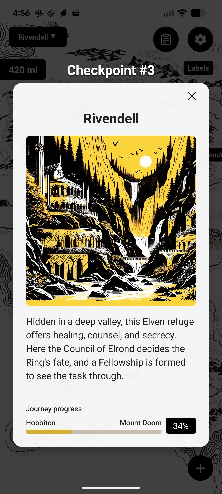

<p align="center">
  
</p>

# Middle-earth Challenge

A fitness tracking app that maps your real-world walking and running distance onto the journey from Bag End to Mount Doom — 1,779 km (1,235 miles) across Middle-earth.

<p align="center">
  
  
  
</p>

### Features

- **Interactive Map** — Pan and zoom across a detailed map of Middle-earth
- **Health Integration** — Syncs with Health Connect (Android) to track your distance automatically
- **Manual Entry** — Add distance manually if you prefer
- **Offline-First** — All data stored locally on your device

## [ Android ] Install the app using Google's App Tester

This app can't be shared through the Play Store, because it has copyrighted content (it references Lord of the Rings). We use **App Tester** — a free app from Google that lets you download beta apps. The process takes a few minutes and requires granting some permissions, but you only need to do it once. Once installed, the Firebase App (App Tester) will allow you to download Middle Earth Challenge. And you don't need to keep App Tester on your phone after you download the Middle Earth Challenge.

**[👉 Get the App](https://appdistribution.firebase.dev/i/9072b5de381cb5a6)**

### Installation Steps

1. **Tap the link above** on your Android device
2. **Download App Tester** — When prompted, allow your browser to install unknown apps:
   - Settings → Apps → Chrome (or your browser) → Install unknown apps → Allow
3. **Install App Tester** and open it
4. **Sign in** with your Google account
5. **Download Middle Earth Challenge** — When prompted, allow App Tester to install:
   - Settings → Apps → App Tester → Install unknown apps → Allow
6. **Open the app** — Find "Middle Earth Challenge" in your app drawer
7. **(Optional) Delete App Tester** — The app runs independently; you'll only need App Tester again if the app needs to be updated

> **Note:** These permissions are required because the app isn't on the Play Store. You can revoke them after installation.

### Having trouble?

- Make sure you're opening the link on your Android device (not a computer)
- Use Chrome or your default browser
- Check your Downloads folder if the APK doesn't install automatically

### Deleting App Tester

Once Middle Earth Challenge is installed, you can delete App Tester if you want — the app runs independently. You'll only need App Tester again if the app needs to be updated.

---

## [ iOS ] Compatible but no download available

The app works on iOS, but I don't have an Apple Developer Program membership, which is required to distribute iOS apps. If you're a developer, you can clone the repo and build it yourself using Xcode.

# For Developers

### Tech Stack

- React Native 0.83
- React Native Skia for map rendering
- Zustand for state management
- OP-SQLite for local persistence
- react-native-health-connect for fitness data

### Prerequisites

- Node.js 20+
- Xcode 15+ (iOS)
- Android Studio (Android)

### Installation

```sh
npm install
cd ios && bundle install && bundle exec pod install && cd ..
```

### Running

```sh
npm start
npm run ios   # or npm run android
```

> **Debug vs Release:** If prompted to "Uninstall" when installing the beta, this happens because debug and release builds use different signing keys. Uninstall the debug version first.

## Credits

- [Map SVG source](https://github.com/k1tesurfen/mapome)

## License

MIT
