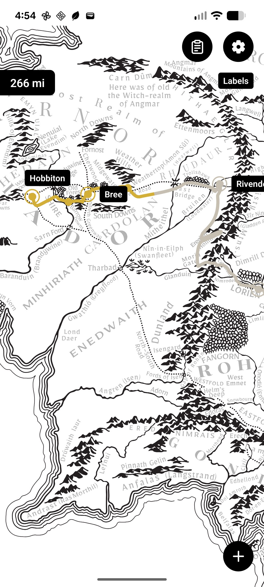
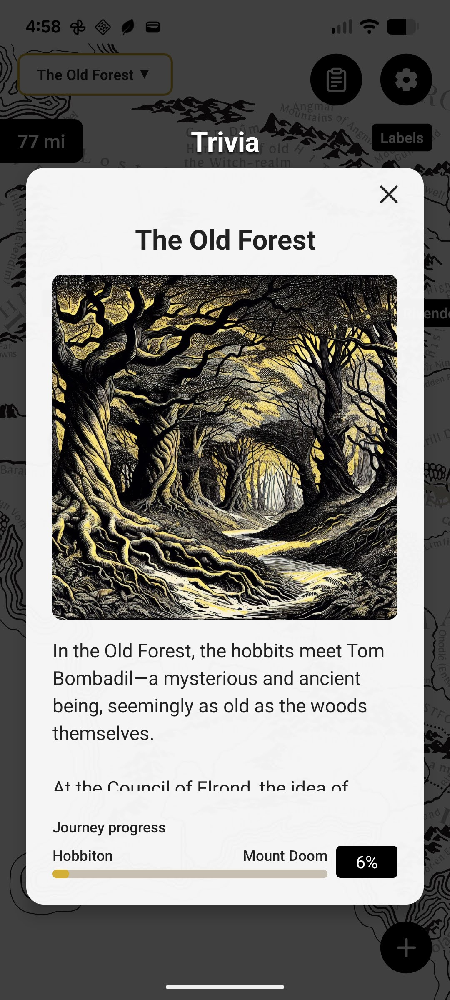
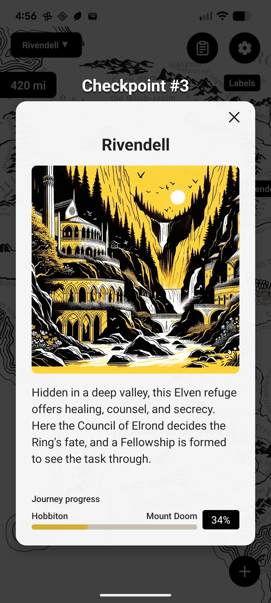

<p align="center">
  
</p>

# Middle Earth Challenge

This app maps the miles you walk onto Frodo’s journey from Bag End to Mount Doom.  It's a 1,235 mile trip across Middle-earth where every step counts towards your progress.

<p align="center">
  
  
  
</p>

### Features

- **Interactive Map** — Pan and zoom across a detailed map of Middle Earth
- **Health Integration** — Syncs with Health Connect (Android) to track your distance automatically
- **Manual Entry** — Add distance manually if you prefer
- **Offline-First** — All data stored locally on your device

# For Developers

### Prerequisites

- Node.js 20+
- Xcode 15+ (iOS)
- Android Studio (Android)

### Installation

```sh
npm install
cd ios && bundle install && bundle exec pod install && cd ..
```

### Running

```sh
npm start
npm run ios   # or npm run android
```

> **Debug vs Release:** If prompted to "Uninstall" when installing the beta, this happens because debug and release builds use different signing keys. Uninstall the debug version first.

### Testing

```sh
npm run test:unit    # Jest — utils, constants, stores, services
npm run test:rules   # Firestore security rules, via the Firebase emulator
npm run typecheck    # TypeScript, app + test configs
npm run lint
```

### Tech Stack

- React Native 0.83
- React Native Skia for map rendering
- Zustand for state management
- OP-SQLite for local persistence
- react-native-health-connect for fitness data
- Firebase (Auth, Firestore, App Check) for friend progress sharing

### Architecture

```
src/
├── screens/     # Top-level app screens
├── components/  # Shared UI
├── services/    # Health/pedometer sync, Firestore sync, database, reconciliation
├── stores/      # Zustand state (progress, friend progress, settings, save state)
├── hooks/       # Shared React hooks
├── utils/       # Pure helper functions
└── constants/   # Shared config and tuning values
```

### Engineering highlights

- **Dual-source activity tracking** — the phone's direct pedometer (real-time, foreground service, screen-off resilient) and Health Connect (covers activity from a watch/ring or other device) can both contribute to the same day without double-counting. See [`docs/dual-tracking-sources.md`](docs/dual-tracking-sources.md) and [`docs/pedometer-mode.md`](docs/pedometer-mode.md).
- **Offline-first with cloud sync** — journey progress lives in local SQLite first and is the source of truth; Firestore sync for friend sharing is additive and never blocks core gameplay if the network is unavailable.
- **Friend progress sharing** — opt-in sharing of total journey distance between participants, with its own caching and sync cadence. See [`docs/shared-progress.md`](docs/shared-progress.md).
- **Firebase App Check** — release builds attest via Play Integrity (Android) and App Attest/DeviceCheck (iOS) before Firestore access is allowed.

### Further reading

More implementation detail lives in [`docs/`](docs/), including iOS modal fixes, keyboard-aware scrolling for inverted lists, and the landscape-mode layout fix.

## Credits

- [Map SVG source](https://github.com/k1tesurfen/mapome)

## License

MIT
